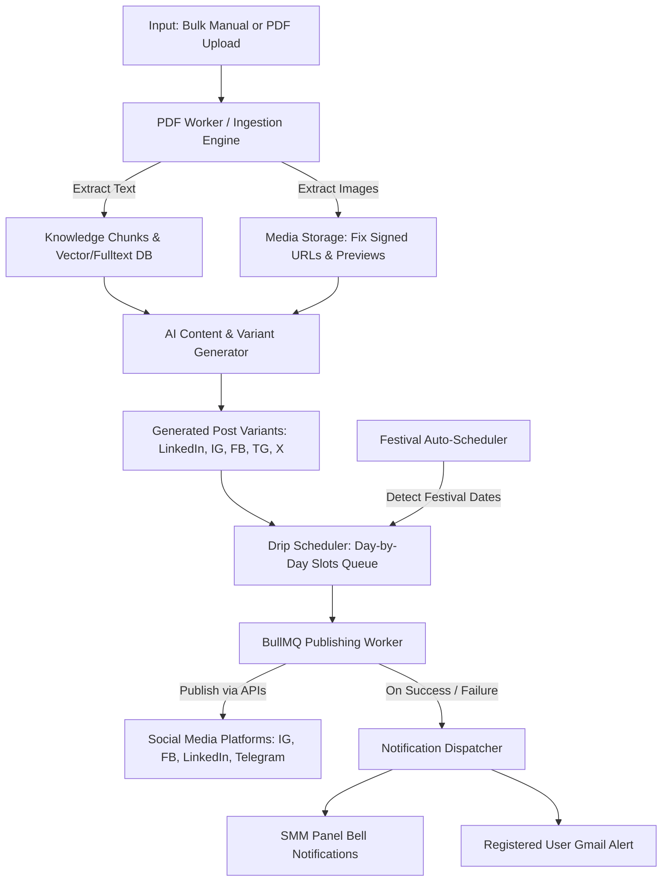

# 📑 Software Requirement Specification (SRS) & Architecture Blueprint
## ContentOS / SMM Panel: Automated Content Engine & Multi-Platform Publishing

---

## 1. Executive Summary & Vision (मुख्य उद्देश्य)
Is project ka primary goal social media posting ko **100% automate** karna hai:
1. **Dual Input Modes:** User chahe **bulk manual content** dale ya fir **PDF document (text + images)** upload kare.
2. **Deep Information Extraction:** PDF se na sirf text extract & chunk ho, balki uske andar ke **saare embedded images aur visuals properly extract hon**, previews load hon (bina broken image icon ke), aur unka visual OCR/analysis ho sake.
3. **AI Post & Creative Generation:** Extracted text aur images se platform-tailored content generate ho:
   - Branded poster / graphic image
   - High-converting Caption + Description
   - Platform-optimized Hashtags
4. **Variant Management ("Generated Variants"):** Har connected platform (LinkedIn, Instagram, Facebook, Telegram, X, YouTube) ke hisab se variants create aur store hon.
5. **Automated Daily Drip Scheduling:** Posts calendar mein automatically set slots (e.g. daily 1-3 posts) ke hisab se day-by-day schedule aur publish hote rahein.
6. **Festival Automation Integration:** Beech mein aane wale Indian/Global festivals ko detect karke branded greetings & posters automatically schedule mein inject karna.
7. **Dual-Channel Notification:** Post publish hone par ya kisi failure par:
   - SMM Panel Notification Bell (In-App)
   - User ki registered signup Gmail / Email par instant email alert.

---

## 2. Gap Analysis: Current Status vs. Desired State

| Component | Current State in Codebase | Desired Target State | Required Action / Gap |
|---|---|---|---|
| **PDF Text Extraction** | Working (`pdf-processing.ts`, chunks + citations) | Working with auto-summaries & key insights | Retain & optimize prompt generation |
| **PDF Image Extraction & Preview** | Broken images in UI (`alt="PDF image from page X"`) | Crisp previews, downloadable, reusable in posts | Fix signed URL / Auth cookie handling in `localDownload` & ensure proper storage paths |
| **Post Variants Generation** | Manual prompt-to-copy in `AIStudio.tsx` | Auto-generates ready-to-publish bundles (caption + description + hashtags + image) | Auto-populate "Generated Variants" with 1-click "Approve & Queue All" |
| **Poster / Creative Generation** | Basic text-card SVG to JPEG (`auto-poster.ts`) | Dynamic poster engine using extracted PDF images + Canvas overlays | Add visual template generator using extracted PDF images |
| **Bulk Direct Mode** | CSV / Bulk draft insertion exists in backend | Unified UI for bulk manual entry + bulk scheduling | Add simple bulk editor / scheduler UI |
| **Daily Scheduling (Drip Feed)** | Slots table exists, manual scheduling per post | Automated daily queue (e.g. Next 7/14/30 days drip feed) | Auto-assign pending variants to upcoming daily slots |
| **Festival Automation** | Working backend logic & DB tables (`festival.service.ts`) | Seamless auto-injection into the daily schedule | Ensure festival posts take precedence without breaking daily limits |
| **In-App Notifications** | Working (`notifications` table + bell icon) | Shows live status (Enqueued -> Publishing -> Published / Failed) | Working; refine payload for quick link to published post |
| **Gmail Notifications** | Mail queue exists for OTP/Auth only | Post published / failed hone par registered user email par email trigger | Add `queuePostPublishedEmail` in `publishing.ts` |

---

## 3. Detailed Functional Requirements (Tameez se Requirements)

### 📌 Module 1: Ingestion & Knowledge Extraction (Input Pipeline)
#### Mode A: Bulk Manual Creation
- User multiple posts ek sath bulk editor ya CSV se input kar sake (Title, Caption, Image, Target Platforms).
- System inko validate kare aur bulk queue mein daal de.

#### Mode B: PDF Document Ingestion (Text + Images)
- **Upload:** Multi-PDF upload (50MB max each), background BullMQ processing.
- **Text & Chunks:** Extract clean text, page numbers, chunks, and citations.
- **Visual Extraction (CRITICAL FIX):**
  - PDF ke har page ke embedded images aur page renditions PNG/JPEG format mein extract hokar storage mein save hon.
  - Image preview URLs ko session-independent presigned URLs / public workspace proxy se load kiya jaye taaki browser mein broken images (`alt="PDF image from page 1"`) na aayein.
  - User kisi bhi extracted image ko 1-click se "Reuse as Post Visual" select kar sake.

---

### 📌 Module 2: AI Creative & Variant Generation Engine
Har content piece ke liye system auto-generate karega:
1. **Visual Poster:**
   - Option A: Extracted PDF Image ko branded frame/logo ke sath scale karna.
   - Option B: Text-card SVG/Canvas branded graphic (gradient, title, highlights).
2. **Platform-Tailored Copywriting:**
   - **LinkedIn:** Thought-leadership tone, clean spacing, 3-5 professional hashtags, char limit < 3000.
   - **Instagram:** Engaging hook, line breaks, call-to-action (CTA), 15-20 relevant hashtags, 1080x1080 JPEG asset.
   - **Facebook:** Conversational tone, link preview / image, char limit < 63k.
   - **Telegram:** Markdown-formatted bold/italic text, direct CTA, photo attachment.
   - **X (Twitter):** Punchy punchline, < 280 chars, 2-3 trending hashtags.
3. **Generated Variants Storage:**
   - Variants directly `content` table mein JSON format (`variants: { [platform]: { caption, mediaUrl, hashtags } }`) ke roop mein save honge.
   - UI ke "Generated Variants" tab mein platform switch karke preview aur inline edit karne ki suvidha hogi.

---

### 📌 Module 3: Automated Daily Drip Scheduler (Day-by-Day Posting)
- **Posting Calendar Rules:**
  - Workspace level posting slots define honge (e.g., Slot 1: 10:00 AM, Slot 2: 03:00 PM, Slot 3: 08:00 PM).
  - Bulk / PDF se bane variants ko "Auto-Schedule Drip" karne par system upcoming days ke slots mein sequentially assign kar dega:
    - Day 1: Post A @ 10:00 AM
    - Day 2: Post B @ 10:00 AM
    - Day 3: Post C @ 10:00 AM ...
- **Queue Execution:**
  - BullMQ `scheduler-maintenance` worker har 5 seconds pe check karke exact time par post ko respective social network API par dispatch karega.

---

### 📌 Module 4: Festival Automation Integration
- **Detection:**
  - System mein Indian & National Festival Calendar configured hai (`festival.data.ts`).
- **Auto-Injection:**
  - Jab daily drip calendar ban raha ho ya running ho, agar kisi date par festival padta hai (e.g. Diwali, Eid, Independence Day, Holi):
  - System automatically festival poster generate karega (branded greeting + canvas/image).
  - Us date ke prime morning slot (e.g. 08:00 AM) par festival post automatically insert ho jayegi.
  - Regular post ko conflict kiye bina ya toh next slot mein shift karega ya daily capacity limit ke hisab se adjust karega (`assertDailySlot`).

---

### 📌 Module 5: Dual-Channel Notifications (SMM Panel + Gmail)
Jab bhi koi automated post execute ho:
#### 1. In-App SMM Panel Notification
- `notifications` table mein instant entry create hogi:
  - **Success:** *"Post published on LinkedIn & Instagram: '[Title]' with post link."*
  - **Failure:** *"Publishing failed on Instagram: '[Error reason]'. Action required."*
- SMM panel ke bell icon badge count update hoga.

#### 2. Gmail / User Registered Email Notification
- User ne jis email se signup kiya hai (Workspace Owner / Author):
- Background Mail Worker (`email-outbox` + `deliverEmails` via Nodemailer/SMTP):
  - **Subject:** `✅ [Published] Your scheduled post is live on {platform}`
  - **Body Template:**
    - Post Title & Platform Name
    - Execution Timestamp
    - Direct Link to live post (provider post URL)
    - Preview of Caption & Thumbnail
  - **Failure Alert (if failed):**
    - **Subject:** `⚠️ [Action Needed] Post publishing failed on {platform}`
    - Exact reason (e.g., Token expired, media format invalid) + link to reconnect account.

---

## 4. Technical Architecture & Data Flow

---

## 5. Step-by-Step Execution Plan (Phase-wise)

### Phase 1: Fix Image Previews & Storage Route (Fixing Screenshot Issue)
- [ ] Local storage signed download endpoint ko audit karna taaki browser `` tags bina 401/404 ke previews render kar sakein (token-in-query-param authentication).
- [ ] Ensure PDF page images status `COMPLETED` mark ho aur UI mein clean thumbnail dikhai de.
- [ ] UI mein "Use this Image for Post" button enable karna.

### Phase 2: Variant Generation & Direct Bulk Queueing
- [ ] "Generated Variants" tab ko enhance karna: Post Title, Multi-platform text, and selected image asset.
- [ ] "Add to Auto-Schedule Queue" button: single-click se sare variants ko database mein `SCHEDULED` status ke sath save karna.

### Phase 3: Festival Automation & Daily Drip Scheduler
- [ ] Drip-feed assignment logic verify aur connect karna (Date + Time Slot mapping).
- [ ] Festival scheduler check ensure karna ki festival wale din automated poster create hokar schedule mein inject ho jaye.

### Phase 4: Email Notification Engine for Publishing
- [ ] `server/publishing.ts` mein post publish hone par `queueEmailNotification` hook integrate karna.
- [ ] Clean HTML Email template design karna (Published vs Failed alerts).
- [ ] Mail worker verify karna ki registered user ki email par turant delivery kare.

---

## 6. Verification & Acceptance Criteria (Quality Check)
1. **PDF Upload Test:** Ek PDF upload karne par text chunks aur saari images bina broken icon ke render hon.
2. **AI Generation Test:** Extracted knowledge se LinkedIn, Instagram, Facebook, Telegram ke variants generate hon (caption + hashtags + media).
3. **Drip Scheduling Test:** Posts consecutive days ke fixed slots par schedule hon.
4. **Festival Test:** Test festival date simulate karne par festival greeting post inject ho.
5. **Publishing & Notification Test:** Test account par post publish hote hi SMM Panel bell icon par aur user ki Gmail par email receive ho.
