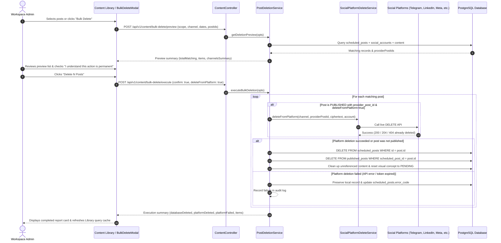

# Workflow: Bulk Post Deletion (`bulk-post-deletion.md`)

This workflow documents the lifecycle of bulk post deletion in ContentOS, explaining how posts are safely removed from external social platforms and local database tables without data corruption or accidental deletions.

---

## 1. Interaction Diagram

---

## 2. Trigger Points

The user can initiate bulk deletion from two distinct locations in the application:
1. **Header "Bulk Delete" Button:** Located in the top action bar of `/app/library`. Clicking opens the modal pre-configured in `all` or `today` scope.
2. **Floating Action Bar ("Delete Selected N"):** When a user checks one or more post checkboxes in the library table, a floating action bar appears with a red **Delete Selected (N)** button. Clicking opens the modal pre-configured with `scope = 'selected_ids'` and the exact list of selected IDs.

---

## 3. Supported Scopes & Filters

* **Scopes:**
  * `all`: Matches every post belonging to the current workspace.
  * `today`: Filters posts where `scheduled_at` or `created_at` falls on today's local date (using `timezoneOffsetMinutes`).
  * `custom_range`: Filters posts between `startDate` and `endDate`.
  * `selected_ids`: Filters strictly to the provided array of `postIds`.
* **Channel Filter:** `all` or a specific channel: `linkedin`, `telegram`, `facebook`, `instagram`, `twitter`, `youtube`.
* **Status Filter:** `all`, `published`, `scheduled` (enqueued/scheduled), or `failed`.
* **Platform Deletion Toggle:** "Also delete from live social platforms" (defaults to `true`).

---

## 4. Live External Social Platform Deletion

When a post is already live (`status = 'PUBLISHED'`) and has a valid `provider_post_id`, `SocialPlatformDeleteService` invokes the respective platform's live API:

| Platform | Endpoint / Method | Success Criteria |
|---|---|---|
| **Telegram** | `POST https://api.telegram.org/bot<token>/deleteMessage` (`{ chat_id, message_id }`) | `result.ok === true` or `"message to delete not found"` |
| **LinkedIn** | `DELETE https://api.linkedin.com/v2/shares/{shareId}` or `/ugcPosts/` or `/rest/posts/` | `HTTP 204`, `200`, or `404` (already removed) |
| **Facebook** | `DELETE https://graph.facebook.com/v22.0/{postId}?access_token={token}` | `HTTP 200` with `{ "success": true }` |
| **Instagram** | `DELETE https://graph.facebook.com/v22.0/{mediaId}?access_token={token}` | `HTTP 200` with `{ "success": true }` |
| **Twitter/X** | `DELETE https://api.twitter.com/2/tweets/{tweetId}` | `HTTP 200` with `{ "data": { "deleted": true } }` |
| **YouTube** | `DELETE https://www.googleapis.com/youtube/v3/videos?id={videoId}` | `HTTP 204` or `404` |

---

## 5. Safety Invariant: Partial Failures

> [!IMPORTANT]
> **Strict Safety Invariant:** If an external platform deletion returns an error (e.g., token revoked, rate limit reached, network timeout), **the local database record is NEVER deleted**.
>
> 1. The local record is retained with status `FAILED` and an error log.
> 2. The item is marked as `status: "FAILED"` in the execution response.
> 3. The user is informed via the results card, preventing desynchronization between ContentOS and social media feeds.

