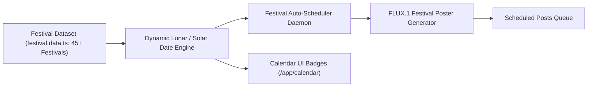

# Workflow: Indian Festival Automation (`festival-automation.md`)

This document outlines ContentOS's automated Indian Festival campaign scheduling engine, covering festival calculation, automated design generation, and multi-channel greetings broadcast.

---

## 1. Overview & Architecture

Indian festivals follow a mix of Gregorian solar dates (e.g. Independence Day, Republic Day, Gandhi Jayanti) and Hindu/Islamic lunar calendars (e.g. Diwali, Holi, Eid ul-Fitr, Ganesh Chaturthi, Raksha Bandhan).

ContentOS embeds a dataset of **45+ comprehensive Indian national, cultural, and spiritual festivals** with calculated dates, greeting templates, and automated publishing workflows.

---

## 2. Key Festivals Supported

The dataset (`server/calendar/festival.data.ts`) includes:
* **National Holidays:** Republic Day (Jan 26), Independence Day (Aug 15), Gandhi Jayanti (Oct 2).
* **Major Spiritual Celebrations:** Diwali, Dhanteras, Bhai Dooj, Govardhan Puja, Chhath Puja, Holi, Maha Shivratri, Krishna Janmashtami, Ganesh Chaturthi, Raksha Bandhan, Ram Navami, Hanuman Jayanti.
* **Harvest & Regional Celebrations:** Makar Sankranti / Pongal / Lohri, Baisakhi, Onam, Ugadi / Gudi Padwa, Durga Puja / Navratri (9 days).
* **Islamic, Christian, Sikh, Jain & Buddhist Celebrations:** Eid ul-Fitr, Eid al-Adha (Bakrid), Muharram, Christmas, Good Friday, Easter, Guru Nanak Jayanti, Guru Gobind Singh Jayanti, Mahavir Jayanti, Buddha Purnima.

---

## 3. Automation Workflow

### Step 1: Automated Detection & Badging
1. The calendar engine calculates upcoming festival dates for the current year.
2. The user views `/app/calendar` and `/app/festivals`:
   * Each festival is marked with a distinctive festival badge, cultural icon, and celebration date.
   * Days with upcoming festivals highlight a celebration badge indicator.

### Step 2: Campaign Configuration
1. In `/app/festivals`, the user can toggle:
   * **Auto-Schedule Festivals:** Automatically creates a scheduled greeting post 24–48 hours before each festival.
   * **Target Channels:** Selects which channels should receive festival greetings (e.g., LinkedIn, Instagram, Telegram).
   * **Greeting Tone:** Professional, Warm, Festive, or Minimal.

### Step 3: Poster Synthesis & Auto-Dispatch
1. `FestivalService.generateFestivalVisual()` generates a festive greeting graphic via FLUX.1.
2. The company logo and brand signature are composited onto the artwork.
3. The post is inserted into `scheduled_posts` claiming the earliest morning slot (e.g. 10:00 AM) on the festival morning.
4. Live dispatch publishes greetings on schedule without requiring manual intervention during holidays.

