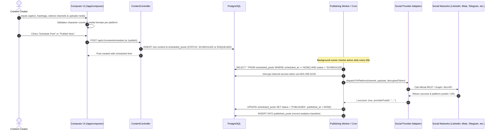

# Workflow: Multi-Platform Publishing (`multi-platform-publishing.md`)

This document outlines the workflow for composing, validating, scheduling, and publishing multi-platform social media posts across all supported channels.

---

## 1. Publishing Flow

---

## 2. Platform Capabilities & Validation Matrix

Each social network enforces distinct payload constraints:

| Platform | Max Caption Length | Supported Media | Video Format Constraints | Required Auth |
|---|---|---|---|---|
| **LinkedIn** | 3,000 chars | Images (JPG, PNG), Documents (PDF), Video | MP4, max 200MB, duration 3s to 10m | OAuth 2.0 (w_member_social) |
| **Telegram** | 1,024 chars (caption with photo) / 4,096 chars (text) | Single photo, photo album, document, video | MP4, max 50MB via Bot API | Bot Token + Chat ID |
| **Facebook** | 63,206 chars | Images (JPG, PNG), Video | MP4, MOV, max 1GB | Meta Graph API (Page Access Token) |
| **Instagram** | 2,200 chars, max 30 hashtags | Single image, Carousel, Video (Reels) | Square 1:1, Vertical 4:5 or 9:16 | Instagram Business API (via Meta) |
| **Twitter / X** | 280 chars (standard) | Up to 4 images or 1 video | MP4, max 512MB | OAuth 2.0 (tweet.write, tweet.read) |
| **YouTube** | Title 100 chars, Desc 5,000 chars | Video only | MP4, MOV, WebM, resolution up to 4K | Google OAuth 2.0 (youtube.upload) |

---

## 3. Cryptographic Token Handling

1. All access tokens and refresh tokens are encrypted in `social_account_tokens` using `encryptToken(token, aad)`:
   * **Algorithm:** AES-256-GCM.
   * **AAD (Additional Authenticated Data):** Composed of `${workspaceId}:${provider}` to prevent cross-tenant token substitution.
2. During publishing, the worker calls `decryptToken(ciphertext, aad)`.
3. If an access token has expired and a refresh token is present, the worker invokes `refreshToken(refreshToken)` before publishing and writes the new encrypted token to the database.

---

## 4. Failure Handling & Automatic Retries

* **Transient Failures (Rate Limits, Network Timeouts, 5xx):**
  * The worker increments `retry_count`.
  * Postpones execution by exponential backoff (2 min, 5 min, 15 min).
* **Permanent Failures (Revoked Permissions, Deleted Account, Invalid Format):**
  * Marked as `status = 'FAILED'`.
  * The error code and exact platform error message are recorded in `scheduled_posts.error_code`.
  * An in-app alert is generated in `notifications` to notify the workspace admin.

