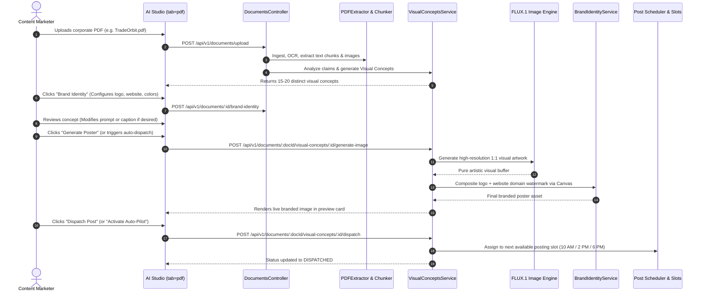

# Workflow: PDF to Social Media Pipeline

This workflow documents the complete end-to-end user journey of taking a corporate PDF document (whitepaper, quarterly report, pitch deck) and transforming it into scheduled, on-brand social media posts across LinkedIn, Telegram, Instagram, Facebook, and X.

---

## Automatic pipeline (current implementation)

An Owner/Admin uploads a completed PDF asset through POST /api/v1/documents. A new workspace's existing knowledge automation settings are initialized in autopilot mode; existing paused/review settings are preserved. No further UI action is required in active autopilot mode. Connected channels and valid subscription capacity are prerequisites.

1. The durable pdf-processing job extracts text, chunks and citation pages. PostgreSQL creates exactly one durable knowledge extraction generation, rather than also launching a duplicate immediate extraction.
2. KnowledgeService extracts source-backed facts and queues a deduplicated document-ready knowledge-automation job. The existing recurring planner fills later slots.
3. KnowledgeAutomationService builds a visual prompt from cited knowledge and calls the existing image provider. Existing approved branding is applied where available. Image/storage work runs outside the scheduling transaction.
4. The existing generateCaptions engine receives the PDF evidence, generated image asset and image prompt. It produces distinct platform captions with relevant hashtags; safety and platform-length checks run before storage.
5. A short transaction rechecks active authorizing membership, source approval, current automation settings and publication quota. Active autopilot records an approval and audit event, then creates existing content/scheduled_posts records. Review mode creates NEEDS_REVIEW content without schedules or automatic approval.
6. The existing publishing worker claims scheduled records and rechecks approval, entitlement and quota before provider calls. Replays respect topic cooldown; existing durable publication identities prevent duplicates.

The phase API now pulses the existing leased PostgreSQL background lane every five seconds, so an API-only deployment drains PDF/extraction/planner jobs without relying on an open browser. The shared lane coordinates with external cron workers. BullMQ retains its existing workers, including document-specific planner jobs.

AI Studio's Create content view displays generated captions and image, and lists automatic post results with schedule/status. It is a monitoring/optional editing surface; it does not drive the background pipeline.

The optional manual visual-concept workflow below remains available. It is not required by autopilot.

## 1. Journey Architecture

---

## 2. Step-by-Step Execution Lifecycle

### Step 1: Document Upload & Parsing
1. The user navigates to `/app/studio?tab=pdf`.
2. Drops a PDF document into the upload dropzone.
3. The server stores the file via `StorageProvider` and creates a row in `documents`.
4. `PDFExtractor` reads textual content with fallback to OCR if pages are scanned or image-heavy.
5. `DocumentChunker` breaks content into contextual chunks and computes citation references.

### Step 2: Visual Concept Generation & Extraction
1. `VisualConceptsService.getOrGenerateConcepts()` checks for existing concepts in `document_visual_concepts`.
2. If concepts do not exist, the LLM service reviews document chunks and extracts 12 to 20 high-value propositions.
3. For each proposition, it crafts:
   * `concept_title`: Focused headline (e.g., "Booster Income Accelerator Tiers").
   * `source_page`: Source citation page number.
   * `source_excerpt`: Exact quote from the document for verification.
   * `prompt`: A high-fidelity FLUX.1 image prompt instructing style, lighting, and composition.
   * `caption`: Multi-paragraph social copy with relevant hashtags.

### Step 3: Brand Identity Extraction & Customization
1. `BrandIdentityService` scans the document for brand markers (detected company name, website URLs, and color palettes).
2. The user clicks **Brand Identity** to open `BrandIdentityModal`:
   * Uploads or selects the company logo.
   * Sets the website domain (e.g., `www.tradeorbit.world`).
   * Configures logo placement (`top-right`, `top-left`, etc.) and margin.
   * Confirms the identity (`status = 'CONFIRMED'`).

### Step 4: Visual Generation & Brand Compositing
1. When generating a concept visual (`POST .../generate-image`):
   * `VisualConceptsService` invokes `ClipdropService.generateImage({ engine: "flux" })`.
   * The **FLUX.1** engine synthesizes a high-fidelity image in under 8 seconds.
   * If Brand Identity is confirmed, `BrandIdentityService.composeBrandOverlay()` uses `@napi-rs/canvas` to draw the transparent logo and domain watermark with correct contrast and safe margins.
   * Both the raw visual and branded poster are uploaded to object storage and attached to the concept row.

### Step 5: Scheduling & Social Dispatch
1. The user clicks **Dispatch Post** on a specific concept card or enables the **Dispatch Queue**.
2. `VisualConceptsService.dispatchConcept()` creates a draft in `content` and schedules publication entries in `scheduled_posts`.
3. The post is linked to configured channels (e.g., LinkedIn, Telegram, Instagram, Facebook).
4. The concept status transitions to `DISPATCHED`.
5. Background cron workers pick up the post at the appointed slot time and publish live to connected networks.

